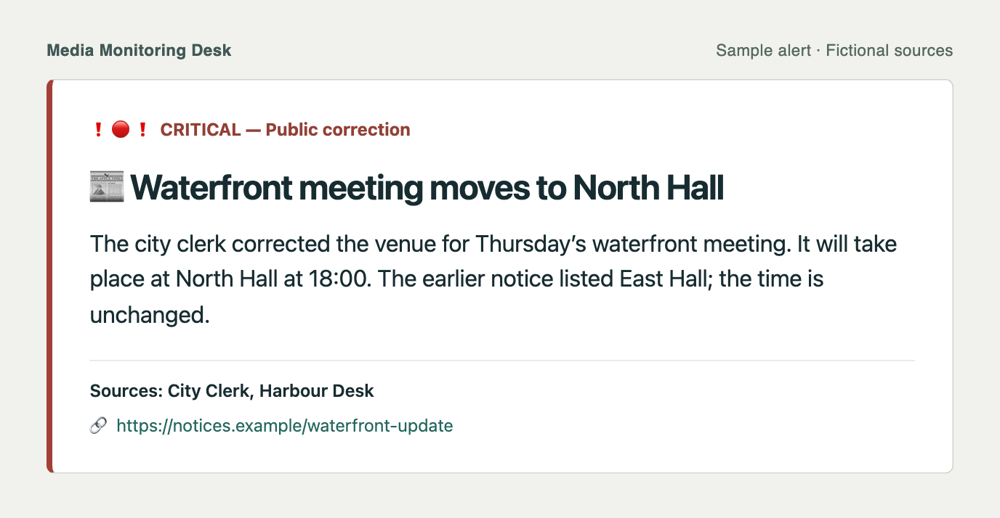

# Media Monitoring Desk

A venue changes just before a public meeting. Two newsrooms report it. The monitoring desk groups their coverage into one alert with the corrected details, both sources and the original link, then sends it to Telegram and WhatsApp.

[](docs/sample-alert.png)

The preview shows the message body captured by both local HTTP receivers during the demo. The event and sources are fictional. [Read the exact payload](docs/sample-alert.txt).

## Try it from a clean clone

With Docker Compose installed, run:

```sh
git clone https://github.com/Dror-Bengal/media-monitoring-desk.git
cd media-monitoring-desk
docker compose run --build --rm monitor
```

The command starts two local RSS feeds, processes five stories, posts to two local provider endpoints, prints the accepted alert and exits. It needs no credentials and uses temporary storage. Once the image is built, the demo operates without internet access.

## What the worker does

- Reads configured RSS feeds and HTML news pages using the original collectors. Tracks each article version by URL, title and content fingerprint.
- Classifies coverage against an editable editorial brief. The local rules distinguish a routine mention from a venue correction. Optional Gemini analysis compares the supplied coverage against the brief and downgrades low-confidence urgent classifications.
- Groups articles using an event key. Critical alerts go out on the next poll. High-priority items are bundled after the hour closes, and medium-priority items are bundled at the first poll after 21:00 UTC. Irrelevant items are skipped.
- Sends a plain-text message using Telegram Bot API or WhatsApp Green-API. SQLite tracks confirmations separately for each channel. If one provider rejects a message, the next cycle retries that channel. A timeout after a provider accepted a message can still result in duplicate delivery.

## Run against your own sources

1. Replace the reserved example URLs in [sources.json](examples/sources.json). For HTML sources, set `name`, `url`, `list_page` and CSS selectors for `article_list`, `title`, `link` and `content`.
2. Edit [the brief and rules](examples/watchlist.json). Rules are evaluated in order. Use `match` for the required phrase and `also_any` for alternate qualifiers. Assign the same `event` key only to reports about the same development.
3. Supply the credentials for your chosen destination or both. Keep them in your shell or an untracked `.env`. A Telegram bot must be allowed to post to the selected chat. WhatsApp uses an authorized Green-API instance.

| Destination | Settings |
| --- | --- |
| Telegram | `TELEGRAM_BOT_TOKEN`, `TELEGRAM_CHAT_ID` |
| WhatsApp | `GREEN_API_URL` (your instance API base), `GREEN_API_INSTANCE_ID`, `GREEN_API_TOKEN`, `WHATSAPP_GROUP_ID` |
| Gemini (optional) | `CLASSIFIER=gemini`, `GEMINI_MODEL`, `GEMINI_API_KEY`. In this mode the selected provider receives article text and the brief. |

After configuring live destinations, `once` runs one real collection and delivery cycle. `watch` repeats it every `POLL_SECONDS` (default 300). Use one worker per state volume. The status command reads the delivery history.

```sh
docker compose run --rm monitor once
docker compose run --rm monitor status
docker compose run --rm monitor watch
```

## Verify both delivery paths

```sh
docker compose run --rm --entrypoint python monitor -m unittest discover -s tests -v
```

The integration tests use local HTTP receivers that validate each provider’s request path, destination and message fields. They cover a successful send, a rejection by either provider, retry without new articles, deduplication across restarts, digest timing, and the classifier’s confidence gate. No real group receives a test message.

[Collectors](pipeline/scrapers/) · [Classifier](pipeline/analysis.py) · [Alert formatting](pipeline/formatting.py) · [Delivery adapters](pipeline/delivery.py) · [Queue and receipts](pipeline/worker.py)

## License

Nayto’s code is distributed under the [MIT License](LICENSE). Third-party software and media retain their respective terms.
